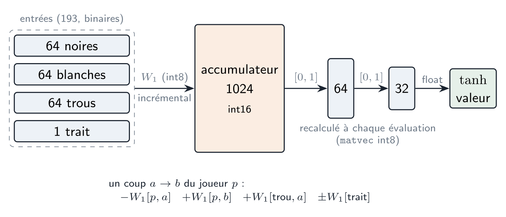
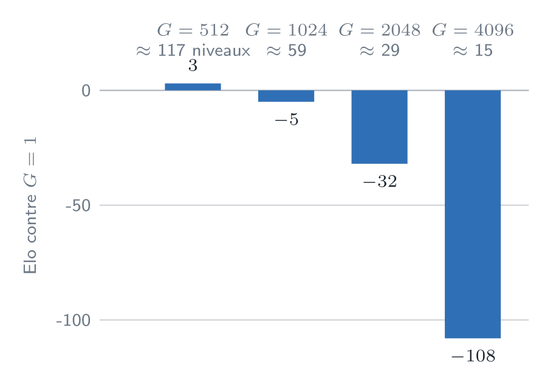
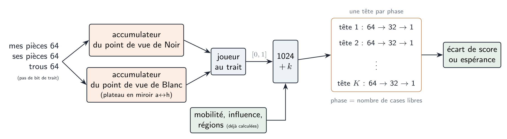
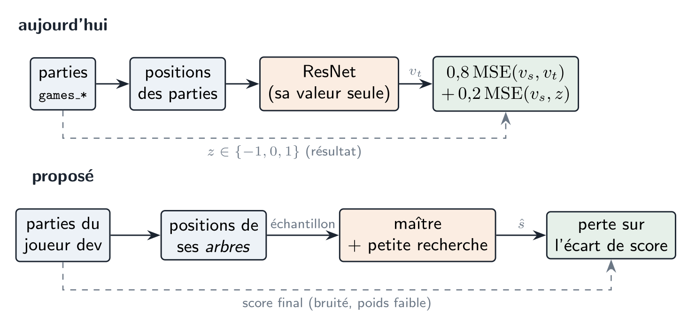
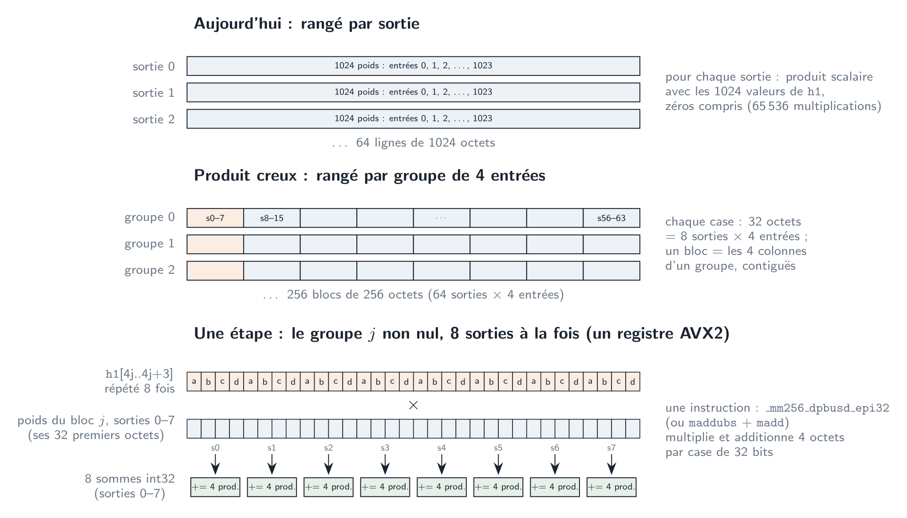
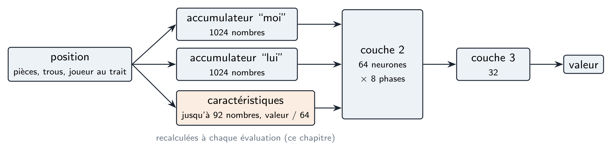
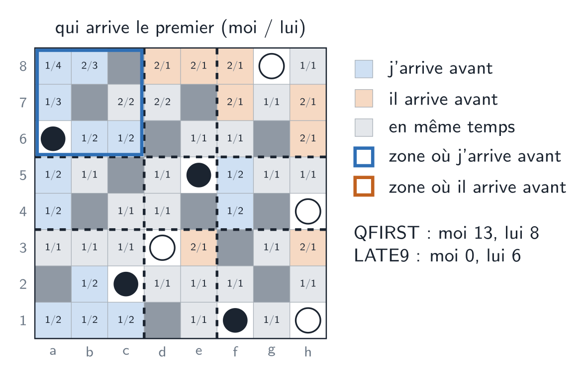
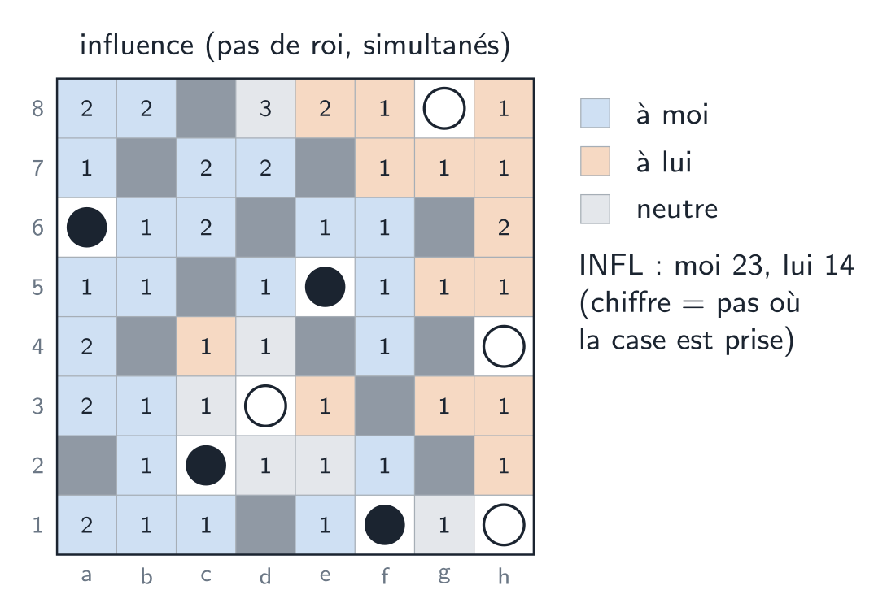
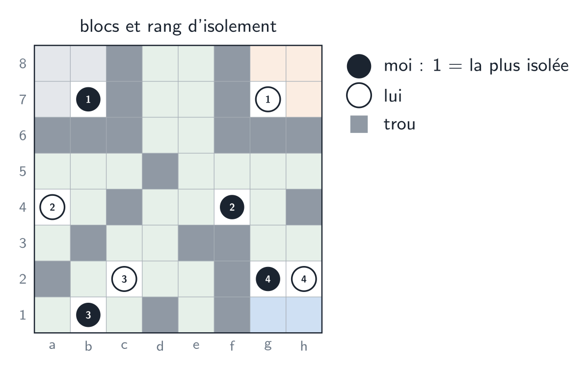

# Où en est-on

La recherche du joueur minimax a été améliorée pas à pas, toujours avec le même réseau
(`nnue_193x1024x64x32x1_distill`, int8). Mesuré contre l'étalon figé (la recherche de
`MinMaxNNUE_QuantizedPlayer` sur un thread), le joueur dev gagne :

| Cadence | 0,2 s | 1 s | 3 s |
|---|---|---|---|
| dev contre étalon (campagne Y7, 2000 / 2000 / 1000 parties) | +280 | +295 | +308 |

Les derniers réglages de la recherche (proxy cut, MPC, ordre des coups, LMR, élagages) sont sur un plateau :
les variantes testées restent à ±5 Elo les unes des autres. Deux mesures disent où se trouve la marge suivante :

- **le réseau coûte cher** : `NNUE_Quantized::value()` représente à lui seul environ 51 % des instructions
  exécutées pendant la recherche (profil callgrind) ; la logique de la recherche, moins de 3 % ;
- **le réseau est loin de son maître** : dans le tournoi de classement (2 s/coup, avant le travail sur la
  recherche), le joueur MCTS avec le ResNet était environ 400 Elo au-dessus du meilleur minimax NNUE. La
  recherche en a rattrapé une partie ; l'écart restant est à remesurer, mais il vient de l'évaluation.

L'étape suivante est donc l'évaluation. Ce document décrit le réseau actuel en partant du code, puis cinq
transformations, de la moins coûteuse à la plus coûteuse, avec à chaque fois ce qui change dans le code.

# Le NNUE d'aujourd'hui

{#fig-now width=95%}

## Les entrées

La position est codée en 193 bits : trois plans de 64 cases (pièces noires, pièces blanches, trous) et un bit
pour le joueur au trait. C'est `preprocess_nnue.py` qui fabrique le cache d'entraînement :

```python
# nnue/preprocess_nnue.py
inputs[cursor, 0:64]    = bb_to_bits(y.black)      # pièces noires
inputs[cursor, 64:128]  = bb_to_bits(y.white)      # pièces blanches
inputs[cursor, 128:192] = bb_to_bits(y.empty)      # trous (cases déjà jouées)
inputs[cursor, 192]     = 0 if black_to_move else 1
values[cursor] = z_black if black_to_move else -z_black   # résultat, pour le joueur au trait
```

## Le réseau

Quatre couches linéaires. Les trois premières utilisent une activation « ReLU écrêtée » à $[0,1]$ et des poids
bornés à $\pm 127/64$, pour pouvoir être quantifiées en int8. La dernière, la tête de valeur, reste libre et
passe par une tanh :

```python
# nnue/nnue193x1024x64x32x1.py
def forward(self, x):
    x = self.fc1(x);  x = torch.clamp(x, min=0.0, max=1.0)   # accumulateur (1024)
    x = self.fc2(x);  x = torch.clamp(x, min=0.0, max=1.0)   # 64
    x = self.fc3(x);  x = torch.clamp(x, min=0.0, max=1.0)   # 32
    return torch.tanh(self.fc4(x)).squeeze(-1)               # valeur dans (-1, 1)
```

## L'inférence en C++ : la mise à jour incrémentale

Tout l'intérêt d'un NNUE est dans la première couche. Un coup de Yolah ne touche que trois entrées : la pièce
quitte la case $a$, arrive sur la case $b$, et $a$ devient un trou. On ne recalcule donc pas le produit
$W_1 x$ : on ajoute ou retranche trois lignes de $W_1$ (et celle du trait) aux 1024 sommes de l'accumulateur :

```cpp
// nnue/nnue_quantized.cpp — NNUE_Quantized::play
int pos = (player == Yolah::BLACK) ? 0 : 64;            // plan des pièces du joueur
int from_offset  = (pos + from) * H1_SIZE;
int to_offset    = (pos + to)   * H1_SIZE;
int empty_offset = (128 + from) * H1_SIZE;              // la case quittée devient un trou
for (int j = 0; j < H1_SIZE; j++)
    a.acc[j] += -input_to_h1[from_offset + j] + input_to_h1[to_offset + j] + input_to_h1[empty_offset + j];
```

Le reste du réseau (1024 → 64 → 32 → 1) est recalculé à chaque évaluation. C'est là que part le temps :

```cpp
// nnue/nnue_quantized.cpp — NNUE_Quantized::value (réseau de valeur)
for (int i = 0; i < H1_SIZE; i++) h1[i] = clamp(a.acc[i], 0, FACTOR);   // ReLU écrêtée, int8
matvec<64, 1024>(h1_to_h2, h1, h2, h2_bias);                           // 64 Ki multiplications
matvec<32, 64>(h2_to_h3, h2, h3, h3_bias);
float s = 0;
for (int i = 0; i < H3_SIZE; i++) s += value_weight[i] * h3[i];        // tête en float
return std::tanh(s / FACTOR + value_bias);
```

La recherche multiplie ensuite cette valeur par `WIN` = 30000 pour obtenir un entier
(`MinMaxNNUE_DevPlayer::raw_network_value`).

## L'entraînement : distillation du ResNet

Le réseau est entraîné par distillation (`distill_common.py`). Le maître est le ResNet valeur/politique du
joueur MCTS. Pour chaque position d'une partie, la perte mélange la valeur du maître $v_t$ et le résultat de
la partie $z$ :

$$
L = \alpha\,\mathrm{MSE}(v_s, v_t) + (1-\alpha)\,\mathrm{MSE}(v_s, z), \qquad \alpha = 0{,}8 .
$$

# Ce qui limite le réseau actuel

**Chaque motif est appris deux fois.** Les entrées disent « noir / blanc » plus un bit de trait. Or la
position de départ est symétrique : le miroir a$\leftrightarrow$h envoie exactement les pièces noires
(a1, h8, d5, e4) sur les pièces blanches (h1, a8, e5, d4). « Ma pièce enfermée dans un coin » doit donc être
appris une fois pour Noir et une fois pour Blanc, et le bit de trait, qui n'agit qu'en ajoutant une seule ligne à
l'accumulateur, peut difficilement retourner le sens de tout le reste.

**Une seule tête pour toute la partie.** En début de partie, tout le plateau est connecté. Vers 24 cases
libres apparaissent des territoires privés, et en dessous de 15 le plateau est découpé en régions séparées.
Ce sont presque des jeux différents, et les 64 + 32 neurones doivent tous les couvrir.

**La cible est grossière.** Le résultat $z \in \{-1, 0, 1\}$ est un seul tirage d'une variable aléatoire, et la
tanh comprime les positions nettement gagnantes vers $\pm 1$. Or la recherche a besoin de nuances. L'étude M
(arrondir la valeur du réseau à un multiple de $G$) a montré qu'il faut au moins 60 à 120 niveaux distincts :

{#fig-grain width=60%}

**Les données ne ressemblent pas aux positions évaluées.** Le réseau apprend sur des positions de parties,
c'est-à-dire des positions où les deux joueurs ont joué de bons coups. La recherche, elle, évalue surtout des
positions issues de mauvais coups (les lignes réfutées des arbres alpha-bêta), qu'il n'a presque jamais vues.

**Il ne voit que des cases, pas des structures.** Mobilité, territoire et régions sont des propriétés globales
qu'un réseau à une couche cachée large reconstruit mal. L'étude J l'a montré à sa façon : l'influence
(le Voronoi en pas de roi) prédit 4 à 6 fois mieux que le hasard le coup du ResNet. La recherche la calcule
déjà pour ordonner les coups.

Les mesures de fin de partie le confirment (positions du cache résolues exactement par `endgame_solver`, outil
`endgame_truth`). On compte les **erreurs de résultat** : la valeur annonce une victoire, une défaite ou une
partie nulle, et le solveur dit autre chose.

| cases libres | maître | NNUE | issue de la partie |
|---:|---:|---:|---:|
| 10 | 0,4 % | 8,0 % | 0 % |
| 14 | 1,8 % | 9,5 % | 0 % |
| 18 | 5,3 % | 12,9 % | 0,1 % |
| 22 | 14,4 % | 18,3 % | 0,1 % |
| 24 | 16,1 % | 16,1 % | 1,2 % |
| 26 | 11,9 % | 15,8 % | 2,5 % |

Entre 10 et 14 cases libres, le maître ne se trompe presque jamais, mais le NNUE se trompe une fois sur dix.
Ce n'est donc pas la cible qui manque : le réseau n'arrive pas à reproduire ce qu'on lui montre. Or ce sont
justement des positions de régions : la moitié des plateaux à 12–15 cases libres sont entièrement séparés
(outil `private_moves`). Deux autres essais vont dans le même sens. Une simple combinaison linéaire des
caractéristiques de territoire de `heuristic_features`, ajustée phase par phase, fait mieux que le réseau à
7 cases libres ou moins, et s'en rapproche entre 8 et 21 (`phase_fit.py`). À l'inverse, des tables de valeurs
par case ou par ligne, qui ne voient pas la connexité, n'apprennent presque rien en fin de partie
(`pattern_fit.py`).

**Au-delà de 28 cases libres, le réseau suit bien le maître.** Le solveur ne suit plus, mais on peut comparer
le NNUE au maître et à l'issue de la partie (616 000 positions du cache) :

| cases libres | NNUE vs maître (mse) | erreurs de résultat vs issue : maître | NNUE |
|---:|---:|---:|---:|
| 12–15 | 0,180 | 1,2 % | 10,3 % |
| 16–19 | **0,226** | 4,6 % | 13,7 % |
| 20–23 | **0,220** | 11,2 % | 17,6 % |
| 24–27 | 0,187 | 16,7 % | 20,9 % |
| 28–31 | 0,149 | 20,6 % | 23,0 % |
| 32–35 | 0,102 | 23,2 % | 24,7 % |
| 36–39 | 0,062 | 24,3 % | 24,6 % |
| 40–43 | 0,035 | 23,4 % | 23,9 % |
| 44–47 | 0,021 | 21,4 % | 22,2 % |
| 48–55 | 0,003 à 0,010 | ~20 % | ~21 % |

L'écart entre le réseau et son maître culmine entre 16 et 23 cases libres, puis se referme : en ouverture, le
réseau reproduit presque exactement le maître. Loin de la fin, les 20 à 25 % d'erreurs contre l'issue ne sont
pas vraiment des erreurs : la partie n'est pas encore décidée, et elle n'est pas jouée parfaitement. À partir de
36 cases libres, le NNUE fait jeu égal avec le maître. En milieu de partie, la limite est donc le maître (ou les
positions d'entraînement), pas le réseau.

**Jusqu'où la recherche voit.** Chaque coup remplit exactement une case libre : la recherche voit la fin de la
partie dès que sa profondeur atteint le nombre de cases libres. Mesuré avec `search_bench` (joueur dev, produit
creux, un cœur de i7-12700K, 209 positions) :

| cases libres | profondeur médiane, 0,2 s | voit la fin | profondeur médiane, 1 s | voit la fin |
|---:|---:|---:|---:|---:|
| 0–23 | jusqu'au bout | 100 % | jusqu'au bout | 100 % |
| 24–27 | 21 | 8 % | 24 | 16 % |
| 32–35 | 19 | 0 % | 22 | 0 % |
| 36–39 | 18 | 0 % | 22 | 0 % |
| 44–47 | 15 | 0 % | 19 | 0 % |
| 48–51 | 13 | 0 % | 16 | 0 % |

Ces profondeurs sont nominales : les lignes réduites (LMR, LMP, MPC, proxy cut) vont moins loin. À 23 cases
libres ou moins à la racine, la recherche n'a plus besoin du réseau. Mais une recherche lancée entre 32 et 40
cases libres atteint une profondeur de 18 à 22 : ses feuilles tombent vers 12 à 25 cases libres, exactement là
où le réseau se trompe le plus. **Améliorer le réseau en fin de partie améliore donc les feuilles de toutes les
recherches du milieu de partie**, là où la partie se décide.

# Les transformations proposées

{#fig-target width=100%}

## Coder du point de vue du joueur au trait

On remplace « noires / blanches / trait » par « mes pièces / ses pièces / trous », vus par le joueur au trait,
avec le plateau en miroir a$\leftrightarrow$h quand c'est Blanc (le miroir qui échange exactement les positions de
départ). Le bit de trait disparaît : 192 entrées.

À l'entraînement, c'est une transformation du cache :

```python
# esquisse : nouvel encodage (preprocess)
def mirror_files(bb: int) -> int:            # a<->h sur chaque rangée
    return int.from_bytes(bytes(int(f'{b:08b}'[::-1], 2) for b in bb.to_bytes(8, 'big')), 'big')

mine, theirs = (y.black, y.white) if black_to_move else (y.white, y.black)
holes = y.empty
if not black_to_move:
    mine, theirs, holes = map(mirror_files, (mine, theirs, holes))
inputs[cursor, 0:64], inputs[cursor, 64:128], inputs[cursor, 128:192] = map(bb_to_bits, (mine, theirs, holes))
```

### Les entrées : trois blocs de 64

Le réseau ne connaît plus les couleurs. Ses 192 entrées, et donc les 192 lignes de la matrice de poids de la
première couche, sont rangées en trois blocs :

| Lignes | Contenu |
|---|---|
| 0–63 | **mes pièces** : celles du propriétaire de l'accumulateur |
| 64–127 | **ses pièces** : celles de l'adversaire |
| 128–191 | les **trous** |

Une pièce sur la case `sq` active la ligne `plane + sq`, avec `plane` = 0 si elle est « à moi », 64 si elle
est « à lui ». Il n'y a **qu'une seule matrice**, partagée par les deux points de vue.

### Deux accumulateurs, un par couleur

Chaque accumulateur appartient à une **couleur fixe**, pas au joueur au trait :

| Accumulateur | Lignes 0–63 | Lignes 64–127 | Cases |
|---|---|---|---|
| `acc[BLACK_VIEW]` | pièces noires | pièces blanches | telles quelles : `sq` |
| `acc[WHITE_VIEW]` | pièces blanches | pièces noires | miroir a$\leftrightarrow$h : `sq ^ 7` |

Le miroir s'applique **toujours** à l'accumulateur blanc, quel que soit le joueur qui joue, et à toutes ses
entrées (pièces des deux couleurs et trous). Avec `sq = 8 × rangée + colonne` (`SQ_A1` = 0, `SQ_H1` = 7),
`sq ^ 7` change la colonne $c$ en $7 - c$ sans toucher à la rangée. Les blancs, qui partent de h1, a8, e5, d4,
se voient ainsi partir de a1, h8, d5, e4, comme les noirs : un seul jeu de poids sert aux deux camps.

`value()` lit l'accumulateur du joueur au trait. Le réseau voit donc toujours « mes pièces dans le bloc 0, sur
un plateau orienté comme pour les noirs ». Mais l'accumulateur lu change à chaque demi-coup.

### Un coup met à jour les deux accumulateurs

La pièce qui bouge est « à moi » dans l'accumulateur de sa couleur et « à lui » dans l'autre. Dans chacun, on la
déplace dans son bloc et on ajoute le trou :

```cpp
// esquisse : NNUE_Quantized::play avec deux points de vue
// Le point de vue noir garde les cases telles quelles ; le point de vue blanc les voit
// dans le miroir a<->h. Avec sq = 8 * rangée + colonne, sq ^ 7 change la colonne c en 7 - c.
constexpr int view_square(int v, int sq) { return v == BLACK_VIEW ? sq : sq ^ 7; }

for (int v : {BLACK_VIEW, WHITE_VIEW}) {
    const bool own = (v == BLACK_VIEW) == (player == Yolah::BLACK);  // la pièce est-elle « à moi » ?
    const int f = view_square(v, from), t = view_square(v, to);
    const int plane = own ? 0 : 64;
    sub_row(a.acc[v], plane + f);   // la pièce quitte f (dans son bloc)
    add_row(a.acc[v], plane + t);   // elle arrive en t (même bloc)
    add_row(a.acc[v], 128 + f);     // f devient un trou
}
```

Exemple, **les noirs jouent d5 → d6** :

| Accumulateur | `own` | `plane` | Cases | Mises à jour |
|---|---|---|---|---|
| `acc[BLACK_VIEW]` | oui | 0 | d5, d6 | `sub(0 + d5)`, `add(0 + d6)`, `add(128 + d5)` |
| `acc[WHITE_VIEW]` | non | 64 | e5, e6 (miroir) | `sub(64 + e5)`, `add(64 + e6)`, `add(128 + e5)` |

Quand l'adversaire joue, notre accumulateur reçoit donc son coup dans le bloc 64.

**Pourquoi tenir les deux à jour à chaque coup.** Un accumulateur doit toujours représenter la position actuelle
complète, vue depuis sa couleur. Or chacun n'est lu qu'un demi-coup sur deux :

| Instant | Trait | Accumulateur lu |
|---|---|---|
| position P | noirs | `acc[BLACK_VIEW]` |
| les noirs jouent d5→d6 → P' | blancs | `acc[WHITE_VIEW]` (le coup noir y est dans le bloc 64) |
| les blancs jouent → P'' | noirs | `acc[BLACK_VIEW]` |

Si `acc[WHITE_VIEW]` ne recevait que les coups blancs, il évaluerait P' sur un plateau où la pièce noire est
encore en d5. Il faudrait alors le reconstruire à chaque lecture, en sommant 30 à 50 lignes (8 pièces plus les
trous), au lieu de 3 lignes par accumulateur et par coup. Dans la recherche, `value()` est appelée aux
profondeurs paires comme impaires, et `undo` dépile l'état du parent : les deux accumulateurs doivent être
justes à chaque nœud de la pile.

### La couche suivante

Deux variantes, à mesurer toutes les deux à l'étape 1 :

```cpp
// esquisse : NNUE_Quantized::value, entrée de la couche 64
const auto& us   = a.acc[side_to_move == BLACK ? BLACK_VIEW : WHITE_VIEW];
const auto& them = a.acc[side_to_move == BLACK ? WHITE_VIEW : BLACK_VIEW];
// (a) h1 = clamp(us)          → 1024 entrées, couche 64 inchangée
// (b) h1 = clamp([us, them])  → 2048 entrées (comme Stockfish)
```

- **(a) `us` seul** : `value()` ne change pas de coût. L'accumulateur de l'adversaire ne sert qu'à préparer
  le demi-coup suivant.
- **(b) `[us, them]`** : on concatène les deux, **toujours dans l'ordre [joueur au trait, adversaire]**.
  La première moitié des poids de la couche 64 s'applique toujours à l'accumulateur du joueur au trait, la
  seconde à celui de l'adversaire. Il n'y a rien à copier : on choisit deux pointeurs selon le trait. Le réseau
  voit aussi la position du point de vue adverse, mais la couche 64 double.

Le coût de `play()` est faible dans les deux cas : 6 additions de lignes de 1024 int16 au lieu de 3. C'est la
règle de tous les NNUE d'échecs depuis Stockfish 12.

## Une tête par phase de jeu

On garde le ou les accumulateurs, mais $K$ jeux de couches 1024 → 64 → 32 → 1. On choisit lequel utiliser
d'après le nombre de cases libres (Stockfish fait la même chose avec le nombre de pièces, $K = 8$). À
l'entraînement, on calcule toutes les têtes et on garde la bonne :

```python
# esquisse : têtes par phase (PyTorch)
class Net(nn.Module):
    def __init__(self, K=8):
        self.fc1  = nn.Linear(192, 1024)
        self.fc2  = nn.Linear(1024, 64 * K)          # les K têtes en un seul produit
        self.fc3  = nn.ModuleList(nn.Linear(64, 32) for _ in range(K))
        self.head = nn.ModuleList(nn.Linear(32, 1) for _ in range(K))

    def forward(self, x, bucket):                    # bucket = f(nombre de cases libres)
        h1 = torch.clamp(self.fc1(x), 0, 1)
        h2 = torch.clamp(self.fc2(h1).view(-1, K, 64), 0, 1)
        h2 = h2[torch.arange(len(x)), bucket]        # la tête de la phase
        ...
```

En C++, `value()` fait le même travail qu'aujourd'hui, seulement avec les matrices de la tête choisie : le
coût ne change pas, la taille du fichier de poids est multipliée par environ $K$ pour les petites couches.

```cpp
// esquisse
const int free_squares = 56 - std::popcount(yolah.empty);   // 8 pièces, un trou par coup
const int k = std::min(K - 1, free_squares * K / 57);
matvec<64, 1024>(h1_to_h2[k], h1, h2, h2_bias[k]);
```

## Des entrées globales après l'accumulateur

Mobilité, comptes d'influence, taille des régions : ces valeurs ne se mettent pas à jour incrémentalement, mais
elles n'ont pas besoin d'entrer dans l'accumulateur. On les concatène à la sortie de l'accumulateur, à l'entrée
de la couche 64 : quelques colonnes de plus dans une petite matrice. La recherche calcule déjà l'influence
(`territory_ordering`, l'ordre des coups par territoire, +36 Elo dans l'étude J), et le cache d'évaluation
évite de la recalculer.

```python
# esquisse : k entrées globales, normalisées dans [0, 1]
h1 = torch.clamp(self.fc1(x), 0, 1)
h1 = torch.cat([h1, globals_], dim=1)            # (B, 1024 + k)
h2 = torch.clamp(self.fc2(h1), 0, 1)
```

**Les régions, exactement et pour presque rien.** Une dame glisse case par case à travers des cases libres :
une pièce ne pourra jamais atteindre que les composantes connexes de cases libres (en 8-connexité) qu'elle
touche. Et le départ d'un coup devient un **trou**, jamais une case libre : une frontière ne se rouvre jamais.
Une composante que seules mes pièces touchent est donc **privée pour toujours**. Un remplissage par bitboards
(`shift_all_directions` répété) donne les composantes ; il suffit ensuite de regarder quelles pièces touchent
chacune. Des entrées possibles, du point de vue du joueur au trait :

- le nombre de cases libres dans mes régions privées, dans les siennes, et dans les régions disputées ;
- le nombre de mes pièces enfermées (qui ne touchent que des régions privées), et des siennes ;
- un bit « plateau entièrement séparé » : il n'y a plus de région disputée, et le résultat ne dépend plus que
  du nombre de coups que chacun peut jouer dans ses territoires.

**Le calcul ne sert qu'en fin de partie.** Mesuré sur 1,85 million de positions du cache :

| cases libres | positions avec une pièce enfermée | plateau entièrement séparé |
|---:|---:|---:|
| 8–11 | 97 % | 86 % |
| 12–15 | 93 % | 55 % |
| 16–19 | 82 % | 19 % |
| 20–23 | 56 % | 3 % |
| 24–27 | 26 % | 0,2 % |
| 28–31 | 8 % | 0 |
| 32 et plus | < 2 % | 0 |

Au-dessus d'environ 28 cases libres, ces entrées valent presque toujours zéro : on peut ne pas les calculer.
Elles ne coûtent donc qu'en fin de partie, là où le réseau se trompe le plus (tableau de « Ce qui limite le
réseau actuel »). Elles se combinent naturellement avec les têtes par phase : la tête de fin de partie reçoit
l'information dont elle a besoin.

Il reste à savoir si le gain en précision compense le coût du calcul, et seul un match le dira. Mais on sait
maintenant que le défaut est réel et où il se trouve.

## Une cible plus fine : l'écart de score

Le score de Yolah donne une cible naturellement graduée : l'écart de points entre les joueurs. Deux formes
possibles :

- **régression** de l'écart final (ou de l'écart prédit par le maître), sans tanh, la valeur entière de la
  recherche étant directement proportionnelle à l'écart prévu ;
- **classes** d'écart (par exemple $-10\ldots+10$ et deux classes « au-delà ») avec une entropie croisée à
  l'entraînement, et l'espérance de l'écart utilisée en jeu. C'est l'idée « des classes pour apprendre, un
  scalaire pour jouer » tirée de l'étude M.

```python
# esquisse : la perte avec des classes d'écart
logits = model(x, bucket)                         # (B, C)
loss   = F.cross_entropy(logits, target_class)    # cible : classe de l'écart (du maître ou de la partie)
value  = (logits.softmax(-1) * class_centres).sum(-1)   # en jeu : l'espérance, un nombre gradué
```

**La dernière ligne, pas à pas.** Elle transforme la sortie du réseau, une liste de probabilités sur des
écarts, en un seul nombre : l'écart attendu, que la recherche utilise comme évaluation.

1. **Les classes.** On découpe les écarts possibles en $C$ classes, par exemple $C = 23$ :

    ```
    classe :   0      1     2   ...   11  ...   21     22
    écart  :  ≤−11   −10   −9   ...    0  ...  +10    ≥+11
    ```

2. **`logits`**, de forme `(B, C)` : pour chacune des $B$ positions du lot, $C$ nombres bruts, un par classe ;
   ce ne sont pas encore des probabilités.
3. **`logits.softmax(-1)`** les transforme en probabilités (positives, de somme 1), sur la dernière dimension,
   celle des classes. Exemple simplifié à 5 classes :

    ```
    écarts       :  −4     −2     0     +2     +4
    probabilités :  0.05   0.10  0.20   0.40   0.25
    ```

4. **`class_centres`** : un tenseur fixe de $C$ nombres, l'écart que représente chaque classe, ici
   `[−4, −2, 0, +2, +4]`. Pour une classe ouverte comme « ≥ +11 », on prend une valeur typique, au mieux l'écart
   moyen observé dans cette classe sur les données.
5. **`* class_centres`** multiplie chaque probabilité par l'écart de sa classe ; PyTorch applique ce vecteur à
   chacune des $B$ lignes :

    ```
    0.05·(−4) = −0.2    0.10·(−2) = −0.2    0.20·0 = 0    0.40·(+2) = 0.8    0.25·(+4) = 1.0
    ```

6. **`.sum(-1)`** additionne sur les classes, un nombre par position, de forme `(B,)` :

    ```
    value = −0.2 − 0.2 + 0 + 0.8 + 1.0 = +1.4
    ```

    C'est l'**espérance** de l'écart : « en moyenne, je m'attends à gagner de 1,4 point ».

**Pourquoi l'espérance et pas la classe la plus probable.** La classe la plus probable (+2 ici) ne prend que
23 valeurs ; or l'étude M a montré qu'avec si peu de niveaux la recherche perd beaucoup (−108 Elo avec
environ 15 niveaux, −32 avec environ 29). L'espérance varie de façon continue : deux positions dont la classe la
plus probable est +2 se distinguent encore (+1,4 contre +1,9). D'où « des classes pour apprendre, un nombre
pour jouer » : à l'entraînement, l'entropie croisée apprend toute la distribution (position sûre ou incertaine,
gain serré ou large) ; en jeu, la recherche reçoit un nombre gradué.

**Le coût en C++.** La dernière couche passe de 32 → 1 à 32 → $C$ (23 × 32 multiplications au lieu de 32,
négligeable devant les 65 536 de la couche 1024 → 64), plus $C$ exponentielles pour la softmax : quelques
dizaines de nanosecondes. L'espérance est ensuite multipliée par une échelle fixe pour donner la valeur entière
de la recherche (par exemple 1 point d'écart = 1000).

**En fin de partie, l'issue de la partie est une meilleure cible que le maître.** La distillation donne 80 %
du poids au maître et 20 % à l'issue réelle de la partie. Or les parties du cache sont jouées parfaitement en
finale : à 22 cases libres ou moins, l'issue est exacte dans 99,9 % des cas, alors que le maître se trompe dans
5 à 14 % des cas entre 18 et 22 cases libres (tableau de « Ce qui limite le réseau actuel »). Il suffit de
faire dépendre ce poids de la phase de jeu : l'issue seule à 22 cases libres ou moins, le mélange actuel
au-dessus. On obtient ainsi des étiquettes exactes de fin de partie sans rien résoudre. Plus tard, une remontée
phase par phase pourrait étendre cette zone exacte : étiqueter les positions à 24 cases libres par une
recherche courte dont les feuilles tombent dans la zone déjà fiable, réentraîner, puis passer à 28 cases
libres, et ainsi de suite.

Le maître actuel ne prédit qu'une valeur dans $(-1, 1)$. Un script d'entraînement de ResNet avec l'écart de
score existe déjà (`nnue/cnn_resnet_with_diff_score.py`) : c'est le point de départ naturel pour un maître qui
prédit l'écart.

## Apprendre sur les positions que la recherche évalue

{#fig-data width=90%}

On fait jouer le joueur dev, et pendant ses recherches on tire au hasard des positions **évaluées** (feuilles et
nœuds internes, y compris les lignes réfutées). Le maître les étiquette, sur le cluster, à environ $10^9$
positions par jour sur une RTX 3080. On peut améliorer l'étiquette en la faisant précéder d'une petite
recherche (quelques centaines de visites MCTS), plus coûteuse mais plus juste que le réseau seul. Cette
transformation demande le plus de travail et de calcul, et c'est probablement elle qui rapporte le plus.

## Taille et vitesse

`value()` représente à elle seule environ 51 % des instructions du joueur. Un réseau plus petit ou plus rapide
peut donc battre un réseau plus juste : chaque nanoseconde gagnée par évaluation se transforme en nœuds, donc en
profondeur. Cette section regarde où part le temps aujourd'hui, puis ce qu'on peut changer.

### Où part le temps aujourd'hui

`value()` écrête l'accumulateur en int8 sur $[0, 64]$, puis enchaîne deux produits matrice–vecteur AVX2 et un
petit produit scalaire en float :

```cpp
// nnue/nnue_quantized.cpp : NNUE_Quantized::value (sortie scalaire)
for (int i = 0; i < H1_SIZE; i++) {
    const int16_t v = a.acc[i];
    h1[i] = v <= 0 ? 0 : (v >= FACTOR ? FACTOR : v);        // FACTOR = 64
}
matvec<64, 1024>(h1_to_h2, h1, h2, h2_bias);                  // 65 536 multiplications
matvec<32, 64>(h2_to_h3, h2, h3, h3_bias);                    //  2 048
for (int i = 0; i < H3_SIZE; i++) s += value_weight[i] * h3[i];  // 32
return std::tanh(s / FACTOR + value_bias);
```

Le produit de `matvec` est `_mm256_maddubs_epi16` suivi de `_mm256_madd_epi16`, ou une seule instruction
`_mm256_dpbusd_epi32` quand VNNI est disponible (`USE_VNNI`). Le décompte par évaluation :

| Étape | Travail | Octets de poids lus | Part des multiplications |
|---|---|---|---|
| écrêtage de l'accumulateur | 1024 int16 → int8 | 2 Ko (l'accumulateur) | — |
| `h1_to_h2` (1024 → 64) | 65 536 mult. int8 | **64 Ko** | **97 %** |
| `h2_to_h3` (64 → 32) | 2 048 mult. int8 | 2 Ko | 3 % |
| tête (32 → 1) | 32 mult. float + `tanh` | 128 o | ≈ 0 |

Et pour `play()`, à chaque coup : 3 lignes de `input_to_h1` (départ, arrivée, trou) plus la ligne du trait, soit
4 lignes de 1024 int8 ajoutées à l'accumulateur int16. Avec le point de vue du joueur au trait, la ligne du
trait disparaît, mais il y a deux accumulateurs : 6 lignes au lieu de 4.

**La couche 1024 → 64 est donc presque tout le coût.** Toutes les pistes ci-dessous la visent.

### La taille de l'accumulateur

Le coût de `h1_to_h2` et celui de `play()` sont proportionnels à la taille $H_1$ de l'accumulateur :

| $H_1$ | Mult. `h1_to_h2` | Poids `h1_to_h2` | Octets lus par `play()` (2 points de vue) |
|---|---|---|---|
| 512 | 32 768 | 32 Ko (tient dans le L1) | 6 Ko |
| 1024 (aujourd'hui) | 65 536 | 64 Ko | 12 Ko |
| 2048 | 131 072 | 128 Ko | 24 Ko |

À 512, `h1_to_h2` tient dans le cache L1 (32 à 48 Ko) : le gain peut dépasser le facteur 2 du nombre de
multiplications. À 2048, il faut que la précision gagnée compense une évaluation près de deux fois plus lente.
Seule une mesure en jeu tranche, et elle ne vaut que **une fois le point de vue et les têtes en place**,
parce que ces deux changements modifient ce que le réseau arrive à apprendre à taille donnée.

### Sauter les zéros de l'accumulateur

**D'où viennent les zéros.** Avant la couche 1024 → 64, `value()` écrête l'accumulateur : toute valeur négative
devient 0, toute valeur au-dessus de 64 devient 64. Avec le réseau actuel, mesuré sur 200 000 positions du cache
d'entraînement (poids quantifiés comme en C++), **87 % des 1024 valeurs de `h1` sont nulles**. Seule une
centaine de neurones est « allumée » dans une position donnée, mais pas toujours les mêmes : aucun neurone n'est
éteint sur toutes les positions.

**Ce que fait `matvec` aujourd'hui.** Il calcule chaque sortie comme un produit scalaire de sa ligne de
poids avec les 1024 valeurs de `h1`, zéros compris : 65 536 multiplications à chaque évaluation, dont 87 %
multiplient par 0.

**L'idée : lire la matrice par colonnes.** Le même produit s'écrit aussi comme une somme de colonnes :

```
h2 = h1[0] · colonne 0  +  h1[1] · colonne 1  +  ...  +  h1[1023] · colonne 1023  +  biais
```

Chaque terme où `h1[i]` vaut 0 n'ajoute rien : on peut le sauter, et ne lire que les colonnes des valeurs non
nulles. Le résultat est **exactement** le même, au bit près : ce sont des sommes d'entiers, et l'ordre des
additions n'y change rien.

{#fig-sparse-principle width=100%}

**Pourquoi des groupes de 4.** L'instruction qui fait le travail, `_mm256_dpbusd_epi32` (ou `maddubs` + `madd`
sans VNNI, comme dans `matvec`), multiplie **4 octets consécutifs** par 4 poids et additionne les 4 produits dans
une case de 32 bits. L'unité naturelle est donc le groupe de 4 entrées : on saute un groupe quand ses 4 valeurs
sont nulles, et on le calcule entièrement sinon. Sur le réseau actuel, **59 % des 256 groupes sont entièrement
nuls** : il reste 41 % des multiplications, soit environ 27 000 au lieu de 65 536.

**Ranger les poids autrement.** Aujourd'hui, `h1_to_h2` est rangé par sortie : 64 lignes de 1024 octets. Pour
lire « les 4 colonnes d'un groupe » d'un seul bloc, on le range par groupe d'entrées : 256 blocs de 256 octets,
chaque bloc contenant, pour les 64 sorties, leurs 4 poids du groupe. C'est une simple permutation des mêmes poids,
faite une fois dans `load()` : rien ne change à l'entraînement ni au fichier de poids.

{#fig-sparse-layout width=100%}

Une étape traite un groupe non nul : ses 4 valeurs, recopiées 8 fois dans un registre de 32 octets, sont
multipliées par les 32 premiers octets du bloc (les poids des sorties 0 à 7), ce qui ajoute leur contribution aux
8 sorties d'un coup ; 8 instructions couvrent les 64 sorties. Contrairement au calcul actuel, il n'y a pas de
somme horizontale à la fin (`m256_haddx8`) : chaque case du registre est déjà une sortie.

```cpp
// esquisse : produit creux pour la couche 1024 → 64
// h1_to_h2_by_group[j * 256 + o * 32 + l * 4 + t] = poids de l'entrée 4j+t vers la sortie 8o+l
const int32_t* groups = reinterpret_cast<const int32_t*>(h1);   // 256 groupes de 4 octets

// 1. La liste des groupes non nuls (8 groupes par registre, un masque de bits, puis ses bits à 1)
//    lut[mask] = les positions des bits à 1 de mask (table de 256 × 8 entiers de 16 bits)
alignas(16) uint16_t nz[256 + 8];
int n = 0;
__m128i base = _mm_setzero_si128();
for (int j = 0; j < 256; j += 8) {
    const __m256i g = _mm256_load_si256((const __m256i*)(groups + j));
    unsigned mask = _mm256_movemask_ps(_mm256_castsi256_ps(
                        _mm256_cmpgt_epi32(g, _mm256_setzero_si256())));   // bit k : groupe j+k non nul
    _mm_storeu_si128((__m128i*)(nz + n), _mm_add_epi16(_mm_load_si128((const __m128i*)lut[mask]), base));
    n += std::popcount(mask);                                // 8 indices écrits, n avance du bon nombre
    base = _mm_add_epi16(base, _mm_set1_epi16(8));
}

// 2. La somme des colonnes des seuls groupes non nuls
__m256i sum[8];                                              // les 64 sorties, en int32
for (int o = 0; o < 8; o++) sum[o] = _mm256_setzero_si256();
for (int k = 0; k < n; k++) {
    const int j = nz[k];
    const __m256i in = _mm256_set1_epi32(groups[j]);          // les 4 valeurs, recopiées 8 fois
    const int8_t* w = h1_to_h2_by_group + j * 256;
    for (int o = 0; o < 8; o++)
        dot_accumulate(sum[o], in, _mm256_load_si256((const __m256i*)(w + 32 * o)));
}
// 3. Biais, décalage de 6 bits et écrêtage dans [0, 64], comme aujourd'hui (sans m256_haddx8)
```

(Un groupe de 4 octets dans $[0, 64]$ vu comme un entier de 32 bits est strictement positif dès qu'un des
octets est non nul : la comparaison `> 0` suffit.)

Pour l'étape 1, la première version faisait une boucle sur les bits du masque (`while (mask) { nz[n++] = j +
countr_zero(mask); mask &= mask - 1; }`). Le nombre de tours change à chaque registre, le processeur se trompe
de branche environ une fois sur 32 octets de `h1`, et cela coûtait plus que les multiplications économisées : le
produit creux était **plus lent** que le produit plein (723 ns contre 689). La table `lut`, reprise de
Stockfish, écrit les 8 indices d'un coup sans aucun branchement.

**Le gain dépend de la phase de la partie.** En début de partie, le plateau est plein et beaucoup de neurones
s'allument ; en fin de partie, la plupart restent éteints :

{#fig-sparse-phase width=80%}

Il reste donc 65 % des multiplications en ouverture et 22 % en fin de partie. Comme la recherche passe beaucoup
de temps en milieu et fin de partie, on peut espérer une couche 1024 → 64 environ deux fois plus rapide en
moyenne, donc un `value()` nettement moins cher. La recherche de groupes non nuls coûte peu : 32 comparaisons
de registres.

**Ce qu'il faut vérifier, et ce qui peut aider.**

- **L'exactitude** : la valeur doit être identique au bit près à celle de `matvec`. `nets_check` peut le
  vérifier directement.
- **Le vrai gain** : moins de multiplications, mais des accès mémoire par blocs dispersés au lieu d'une lecture
  continue, et une boucle de longueur variable. Seule une mesure de `value()` puis des nœuds par seconde
  (`search_bench`) le dira (mesures ci-dessous).
- **Regrouper les neurones qui s'allument ensemble.** Permuter les 1024 neurones (lignes de `fc1` et colonnes de
  `fc2` dans le même ordre) ne change pas le réseau, mais si des neurones souvent allumés ensemble se retrouvent
  dans les mêmes groupes, il y a plus de groupes entièrement nuls : on passe de « 87 % de valeurs nulles » vers
  « 87 % de groupes nuls ». Stockfish fait cette permutation à partir de statistiques sur des positions.
- **Encourager les zéros à l'entraînement** : une petite pénalité sur `h1` (L1) pousse plus de neurones à rester
  éteints. À doser : trop forte, elle coûte en précision.
- **Avec le produit par paires** (ci-dessous), le produit est nul dès qu'une des deux moitiés l'est : encore plus
  de zéros à sauter.

**Implémentation et mesures.** Le produit creux est dans `nnue/sparse_matvec.h`, utilisé par `NNUE_Quantized`
(le réseau 193) et `NNUE_Persp` ; le joueur dev l'active par l'option `"sparse h1": true` (désactivé par défaut,
le temps du match). Sans VNNI, deux groupes partagent un même `madd` : leurs deux `maddubs` s'ajoutent en 16
bits sans saturer, car `h1` ≤ 64 (2 × 64 × 127 × 2 = 32 512 < 32 767). Mesures sur i7-12700K, un cœur :

| | produit plein | produit creux | |
|---|---:|---:|---:|
| `value()`, réseau 193 | 685 ns | 453 ns | −34 % |
| `value()`, NetPersp K = 8 (essai) | 758 ns | 515 ns | −32 % |
| `value()`, NetPersp K = 8 + THEM (essai) | 1342 ns | 931 ns | −31 % |
| `search_bench`, profondeur 9, 209 positions | 1,60 s | 1,27 s | −21 % |

`nets_check check_sparse` : 0 valeur différente sur les 83 332 positions de 3000 parties, pour les trois
réseaux. `search_bench` : même arbre, même valeur et même coup sur 209/209 positions. Ce que vaut ce gain de
vitesse en Elo se mesure par la campagne S1 (`dev_y7_sparse` contre `dev_y7`, 4000 parties à chaque cadence) :

| cadence | score | Elo | intervalle à 95 % |
|---|---:|---:|---|
| 0,2 s par coup | 58,7 % | +60,7 | [+52,8 ; +68,7] |
| 1 s par coup | 55,0 % | +34,9 | [+27,7 ; +42,3] |

Le gain baisse quand le temps augmente, comme pour tout gain de vitesse : 21 % de nœuds en plus valent moins
quand la recherche est déjà profonde. Le produit creux est activé par défaut (option `sparse h1`).

### Le produit par paires

Stockfish coupe l'accumulateur en deux moitiés et multiplie les deux, terme à terme, après écrêtage. La couche
suivante reçoit 2 fois moins d'entrées, donc coûte 2 fois moins. Le produit apporte en plus une non-linéarité
que la ReLU écrêtée seule n'a pas :

```python
# esquisse : produit par paires (PyTorch), accumulateur de 1024
h1 = torch.clamp(self.fc1(x), 0, 1)
h1 = h1[:, :512] * h1[:, 512:]          # 512 entrées pour fc2 au lieu de 1024
h2 = torch.clamp(self.fc2(h1), 0, 1)    # nn.Linear(512, 64)
```

```cpp
// esquisse : en C++, le produit de deux valeurs dans [0, 64] ramené dans [0, 64]
for (int i = 0; i < H1_SIZE / 2; i++) {
    const int x = std::clamp<int>(a.acc[i], 0, FACTOR);
    const int y = std::clamp<int>(a.acc[i + H1_SIZE / 2], 0, FACTOR);
    h1[i] = (x * y) >> 6;                  // / FACTOR
}
matvec<64, H1_SIZE / 2>(h1_to_h2, h1, h2, h2_bias);
```

Le produit retombe dans $[0, 64]$, donc la suite de `value()` ne change pas. Le produit par paires produit
aussi beaucoup de zéros (il suffit qu'une des deux moitiés soit nulle), ce qui se combine bien avec le produit
creux.

### La SCReLU

C'est l'alternative au produit par paires : on garde toutes les entrées, mais on élève au carré la valeur
écrêtée, `SCReLU(a) = clamp(a, 0, 1)²`. Elle n'allège pas la couche suivante ; elle donne plus de capacité pour
le même coût. En C++, c'est le même calcul que ci-dessus avec `y = x`. Il faut choisir entre les deux par la
mesure, pas les cumuler.

### Pourquoi le carré ou le produit donnent plus de capacité

**Aujourd'hui, avec la CReLU.** Un neurone de l'accumulateur est une somme, où `x[...]` vaut 1 si l'entrée est
active (une pièce ou un trou sur cette case), 0 sinon :

```
a = b + w[d5]·x[d5] + w[e5]·x[e5] + w[c3]·x[c3] + ...
```

Si `a` reste entre 0 et 1, la CReLU le laisse passer tel quel. Une pièce en d5 ajoute alors toujours `w[d5]` à
`a`, que e5 soit un trou ou non : **l'effet de d5 ne dépend pas du reste du plateau**. La couche suivante fait
elle aussi des sommes, donc tant que tous les neurones restent entre 0 et 1, le réseau entier n'est qu'une somme
de contributions, une par case. Il ne peut pas dire « d5 vaut plus *si* e5 est un trou ».

La seule façon d'y arriver passe par les coupures en 0 et en 1. Exemple, avec un neurone réglé pour cela :

```
a = −1 + 0,8·x[d5] + 0,8·x[e5]

d5 seul       : a = −0,2  → CReLU → 0      (éteint)
e5 seul       : a = −0,2  → CReLU → 0      (éteint)
d5 et e5      : a = +0,6  → CReLU → 0,6    (allumé)
```

Le biais −1 tient le neurone sous 0 ; il ne s'allume que si d5 **et** e5 sont présents : c'est un « ET » obtenu
par le seuil. Mais il faut un neurone entier pour cette paire, et dans une vraie position les autres cases
ajoutent aussi leurs poids à `a`, ce qui déplace le seuil. Pour couvrir beaucoup de paires de cases, et de façon
fiable, il faut beaucoup de neurones.

**Avec la SCReLU**, on élève au carré. Avec seulement deux entrées, pour voir ce qui se passe :

```
a  = b + p·x[d5] + q·x[e5]

a² = b²
   + 2b·p·x[d5] + 2b·q·x[e5]      ← partie additive, comme avant
   + p²·x[d5] + q²·x[e5]          ← idem (x² = x quand x vaut 0 ou 1)
   + 2·p·q · x[d5]·x[e5]          ← NOUVEAU : vaut 1 seulement si d5 ET e5 sont actifs
```

Le terme `x[d5]·x[e5]` est une **interaction entre deux cases**. Avec toutes les entrées, et pas seulement
deux, le carré d'un neurone `n` contient un terme pour **chaque paire** de cases `(f, g)`, de poids
`w_n[f]·w_n[g]`. Un seul neurone porte donc toutes les paires à la fois, mais leurs poids ne sont pas libres :
ils sont tous fabriqués à partir des mêmes 192 nombres `w_n[·]`. Un neurone ne peut pas, par exemple, renforcer
la paire (d5, e5) sans toucher aussi aux paires (d5, c3), (e5, c3), etc.

C'est la couche suivante qui donne la liberté. Une de ses sorties additionne les 1024 carrés avec ses propres
poids `c[n]` ; le poids final de la paire (f, g) devient :

```
poids(f, g) = c[1]·w_1[f]·w_1[g] + c[2]·w_2[f]·w_2[g] + ... + c[1024]·w_1024[f]·w_1024[g]
```

Chaque neurone ajoute un « motif de paires » de forme imposée, et la somme de 1024 motifs pondérés peut
approcher presque n'importe quel tableau de poids de paires. Il n'y a que 192 entrées, donc 192 × 192 paires,
et en algèbre linéaire 192 motifs bien choisis suffisent déjà à reproduire n'importe quel tableau symétrique de
cette taille. Avec 1024 neurones, le réseau peut donc, en principe, donner à chaque paire de cases le poids qu'il
veut. En pratique, les mêmes poids servent aussi à la partie additive et aux coupures en 0 et 1, donc tout
n'est pas libre, mais l'idée est là.

« Plus de capacité » veut donc dire :

- **autant de poids** qu'avant ;
- **presque le même coût** : 1024 multiplications de plus, contre 65 536 dans `h1_to_h2` ;
- **des fonctions plus riches** : des produits de cases, et pas seulement des sommes.

**Le produit par paires** fait la même chose en plus souple, parce qu'il multiplie deux neurones *différents* :

```
a1 = b1 + p1·x[d5] + q1·x[e5] + ...
a2 = b2 + p2·x[d5] + q2·x[e5] + ...

a1·a2 contient (p1·q2 + q1·p2) · x[d5]·x[e5]
```

Le poids de l'interaction vient de deux jeux de poids indépendants : il a plus de liberté. En plus, la couche
suivante reçoit deux fois moins d'entrées.

**Les réserves.** Le gain n'est pas garanti et se mesure en jeu. En int8, `a` va de 0 à 64, donc `a²` va
jusqu'à 4096 : il faut diviser par 64 (`>> 6`) pour revenir entre 0 et 64, et on perd de la précision sur les
petites valeurs, là où le carré écrase déjà tout.

### La place dans les caches du processeur

Une évaluation lit toute la matrice `h1_to_h2` : elle doit rester dans le cache L2. Les têtes par phase
multiplient le nombre de ces matrices par $K$, mais une évaluation n'en lit qu'une. Une tête couvre environ
57 / 8 ≈ 7 demi-coups, et les feuilles d'une même recherche sont à quelques demi-coups les unes des autres :
une ou deux têtes alternent pendant une recherche. Ce qui compte, c'est donc ces une ou deux matrices, selon
les machines :

| Machine | L2 par cœur | 1024 → 64, 1 à 2 têtes (64–128 Ko) | `[us, them]` 2048 → 64, 1 à 2 têtes (128–256 Ko) |
|---|---|---|---|
| i7-12700K (poste) | 1,25 Mo | dans le L2 | dans le L2 |
| Xeon Silver 4214R (crn20–24) | 1 Mo | dans le L2 | dans le L2 |
| EPYC 7662 (crn12, crn13) | 512 Ko | dans le L2 | dans le L2, serré |
| Xeon E5-2650 v4 (crn01–07) | **256 Ko** | limite avec deux têtes | **déborde vers le L3** |

La table de transposition et le cache d'évaluation partagent ce L2. Le produit par paires divise ces
tailles par deux et redonne de la marge partout.

### Comment mesurer

1. **La vitesse d'abord.** Nœuds par seconde avec `search_bench`, à profondeur fixe sur les mêmes positions,
   pour chaque variante : $H_1$ = 512, 1024, 2048 ; produit par paires ou non ; $K$ = 1, 4, 8. Ces mesures se
   font avec des poids aléatoires, sans entraînement, sauf pour le produit creux : sa vitesse dépend de la
   proportion de zéros, donc des poids appris. Les faire sur votre machine **et** sur un E5-2650 v4,
   la machine où les caches sont les plus petits.
2. **La précision ensuite.** Erreur de validation de chaque variante entraînée, avec les mêmes données.
3. **L'Elo enfin**, en jeu à 1 s/coup, pour les deux ou trois variantes qui offrent le meilleur compromis.

Au passage, dans `nnue/nnue_quantized.h:24`, `h2_to_h3` est déclaré avec `H1_SIZE * H2_SIZE` (64 Ko) alors que
seuls 64 × 32 = 2 Ko servent. Ces octets ne sont jamais lus, donc ils ne coûtent rien en cache, mais la taille
est fausse et sera à corriger en même temps.

# Les caractéristiques candidates

La section « Des entrées globales après l'accumulateur » posait le principe : quelques nombres calculés sur
la position, ajoutés à l'entrée de la deuxième couche. Ce chapitre décrit précisément chacun des nombres
candidats : l'idée de jeu qu'il traduit, sa définition exacte, un schéma, le code qui le calcule, ce que les
mesures en ont dit et ce qu'il coûte. Le chapitre suivant décrit l'ablation qui choisira lesquels garder.

## Avant de commencer : quatre points communs à toutes les caractéristiques

### Où elles entrent dans le réseau

Le réseau calcule d'abord deux grands vecteurs de 1024 nombres, les accumulateurs : l'un décrit la position
vue par le joueur au trait, l'autre vue par son adversaire. Ils sont mis à jour à chaque coup, sans être
recalculés. Les caractéristiques de ce chapitre sont des nombres en plus, calculés directement sur la
position à chaque évaluation, et ajoutés à côté des accumulateurs à l'entrée de la deuxième couche.

{#fig-feat-where width=95%}

### Chaque caractéristique est calculée deux fois : pour moi et pour lui

« Moi » désigne toujours le joueur **au trait** (pions noirs pleins sur les schémas), « lui » son adversaire
(pions blancs), quelle que soit leur couleur. Chaque caractéristique donne donc deux colonnes : la valeur
pour moi et la valeur pour lui. Par exemple, pour la mobilité : mes 38 coups légaux et ses 35.

Pourquoi ne pas donner directement la différence 38 − 35 ? Parce que les deux côtés ne pèsent pas pareil :
l'étude de territoire a montré qu'une case de mobilité retirée à l'adversaire compte plus qu'une case de
mobilité gagnée pour soi. Avec les deux valeurs, le réseau apprend lui-même le bon poids de chacune.

### Chaque colonne est un entier de 0 à 64

Le réseau reçoit $\text{valeur}/64$, donc un nombre entre 0 et 1. Ce choix a une raison pratique : dans le
réseau quantifié du C++, les entrées sont des entiers sur 8 bits à l'échelle 64, et l'entrée est alors
exactement l'entier calculé. Le réseau du C++ voit donc exactement ce que le réseau a vu pendant
l'entraînement, sans aucune erreur d'arrondi.

Pour que toutes les colonnes utilisent bien cette plage, deux règles :

- **les petits comptes sont multipliés.** Un nombre de pièces (0 à 4) est multiplié par 16 : 3 pièces
  donnent 48, que le réseau reçoit comme 0,75 ;
- **les distances sont inversées**, en $64/d$ : une distance de 1 donne 64, de 2 donne 32, de 3 donne 21, et
  « jamais » donne 0. Ainsi, plus c'est proche, plus le nombre est grand, et l'absence de chemin n'est pas
  confondue avec une distance énorme.

Les valeurs plus grandes que 64 (une mobilité de 80 en ouverture) sont ramenées à 64.

### Une position et son miroir donnent les mêmes valeurs

Pour que les deux couleurs partagent les mêmes poids, le réseau voit les positions des Blancs retournées
de gauche à droite (la colonne a devient la colonne h). Une caractéristique doit donc donner exactement la
même valeur sur une position et sur son reflet ; sinon, le réseau recevrait deux nombres différents pour la
même situation selon la couleur du joueur au trait.

**Les comptes ne posent aucun problème.** « J'atteins 23 cases en un coup de dame » reste vrai dans le
reflet : on retourne le plateau, pas les distances. C'est le cas de CORR, des distances de dame, de
l'influence et des sommes de l'encerclement.

**Le piège vient des listes de pièces** (connectivité, encerclement). Prenons l'encerclement. Pour chacune
de mes 4 pièces, on calcule trois nombres :

- ses **libertés** : ses cases voisines libres ;
- sa **gêne** : combien de cases ses lignes de dame perdent à cause des pièces adverses ;
- son **attaque** : combien de ses libertés l'adversaire atteint en un coup de dame.

Ici, la gêne sert seulement à ranger les pièces : elle n'est pas écrite pièce par pièce (on la retrouve
dans les totaux du camp, décrits avec l'encerclement, @sec-encircle). Chaque pièce écrit seulement deux
nombres : **8 × attaque** et
**64 × fermable** (1 si elle n'a qu'une liberté et que l'adversaire peut y aller). Les pièces sont rangées
de la plus encerclée à la moins encerclée : le moins de libertés d'abord, puis la plus gênée, puis la plus
attaquée. Supposons qu'on s'arrête aux deux premiers critères, **libertés puis gêne** :

| pièce | libertés | gêne | attaque | écrit (8 × attaque, 64 × fermable) |
|---|---|---|---|---|
| a1 | 1 | 3 | 1 | (8, 64) |
| h8 | 1 | 3 | 0 | (0, 0) |

- Les deux pièces sont à égalité sur les deux critères (1 liberté, gêne 3) : le tri garde l'ordre dans
  lequel on les a parcourues, celui des cases, a1 avant h8. Colonnes : **(8, 64), (0, 0)**.
- Dans le reflet, a1 devient h1 et h8 devient a8 : a8, la pièce non attaquée, est maintenant parcourue en
  premier. Colonnes : **(0, 0), (8, 64)**.

Même situation, entrée différente : la case a décidé de l'ordre.

**La parade : que la clé de tri contienne tout ce que la pièce écrit.** La pièce écrit son attaque et
« fermable », qui se déduit des libertés et de l'attaque. Avec le troisième critère, l'attaque, la pièce
attaquée passe toujours en premier, quelle que soit sa case : colonnes **(8, 64), (0, 0)** dans les deux
cas. Deux pièces encore à égalité sur les trois critères ont les mêmes libertés et la même attaque : elles
écrivent les mêmes deux nombres, et leur ordre, qui dépend encore de la case, n'a plus d'importance. La
connectivité suit la même règle : ses 5 nombres par pièce sont tous dans sa clé de tri.

Vérification : les 92 colonnes calculées sur 500 positions et sur leurs reflets sont identiques partout.

### Comment lire les mesures « ce que la caractéristique ajoute »

Chaque section donne des chiffres comme « +18,6 / +1,9 en finale 10–19 ». Ils répondent à la question :
**que sait cette caractéristique que le réseau actuel ne sait pas déjà ?** Voici le calcul, étape par
étape.

#### 1. Les données et les deux cibles

12 millions de positions de parties réelles (`data/games`, une position sur 20). Pour chaque position, on
connaît la valeur du réseau actuel, la caractéristique, et la suite de la partie. On cherche à prédire deux
**cibles**, vues du joueur au trait :

- les **points restants** : l'écart final (mes points − ses points en fin de partie) moins l'écart actuel.
  C'est ce que la suite de la partie va encore changer au score ;
- le **résultat** : +1 si je gagne, 0 en cas de nulle, −1 si je perds.

Le premier chiffre (« +18,6 ») porte sur les points restants, le second (« +1,9 ») sur le résultat.

#### 2. On compare des positions du même stade

Prenons une caractéristique simple : Q1, le nombre de cases libres que j'atteins en un coup de dame. En
ouverture, il reste beaucoup de cases libres et Q1 vaut souvent 30 ; en finale, il en reste peu et Q1 vaut
plutôt 8. Or la cible dépend aussi du stade de la partie et du joueur au trait : par exemple, si les Noirs
au trait avec 45 cases libres finissent en moyenne avec +3 points, mais avec +1 seulement à 15 cases
libres, alors « Q1 grand » va de pair avec « beaucoup de points restants », simplement parce que les deux
signalent l'ouverture. Q1 aurait l'air de prédire la suite, sans rien savoir de la position elle-même.

Pour l'éviter, on range les positions en **groupes de semblables** : même nombre de cases libres et même
couleur au trait (57 × 2 groupes : de 56 cases libres au départ, 64 cases moins les 8 pièces, à 0 en fin
de partie). Dans chaque groupe, on retire à chaque nombre (la cible, la valeur du
réseau, la caractéristique) sa moyenne dans le groupe :

```
groupe « 45 cases libres, Noirs au trait » : moyenne de Q1 = 30, moyenne des points restants = +3
  position P : Q1 = 34, points restants = +7   →   Q1 centré = +4, points centrés = +4
  position R : Q1 = 27, points restants = +1   →   Q1 centré = −3, points centrés = −2
```

Après ce centrage, un nombre ne dit plus « on est en ouverture » mais « cette position a plus (ou moins) de
Q1 que les autres positions au même stade ». C'est le sens de « on compare des positions du même stade » :
seul ce qui distingue une position de ses semblables peut encore prédire la cible.

#### 3. Deux prédictions

Deux nombres décrivent chaque position :

- **v**, la valeur que le réseau actuel donne à la position, entre −1 et +1 (par exemple +0,4 : le joueur au
  trait est un peu mieux) ;
- **f**, la caractéristique. La plupart en ont deux colonnes, une pour moi et une pour l'adversaire : pour le
  flood fill corrigé, par exemple, f₁ = 20 cases pour moi et f₂ = 14 pour lui.

Tous deux sont centrés comme à l'étape 2. On fait alors deux prédictions de la cible :

- **le réseau seul** : cible ≈ a·v + b·v² + c·v³. Le polynôme de degré 3 laisse au réseau toutes ses chances :
  sa valeur n'est pas forcément proportionnelle aux points (elle sature près de ±1, par exemple) ;
- **le réseau plus la caractéristique** : cible ≈ a·v + b·v² + c·v³ + d₁·f₁ + d₂·f₂, avec un coefficient par
  colonne de la caractéristique (2 pour le flood fill corrigé, 40 pour la connectivité).

Les coefficients (a, b, c, d₁, d₂…) sont ceux qui rendent la somme des carrés des erreurs la plus petite
possible (moindres carrés).

#### 4. Ajustement sur une moitié, mesure sur l'autre

Les positions sont rangées partie par partie. Les coefficients sont calculés sur la **première moitié**, et
les erreurs mesurées sur la **seconde**, qui contient d'autres parties. Une caractéristique à 40 colonnes ne
peut donc pas gagner en apprenant les données par cœur : ses 40 coefficients doivent aussi marcher sur des
parties qu'ils n'ont jamais vues. (Les toutes premières mesures, sur une ou deux colonnes, ont été faites sur
toutes les données ; avec si peu de coefficients et des millions de positions, l'écart est négligeable.)

#### 5. Le R² et le gain

Le **R²** est la part des variations de la cible que la prédiction explique :

$$R^2 = 1 - \frac{\text{moyenne des carrés des erreurs (cible − prédiction)}}{\text{variance de la cible}}$$

Il vaut 0 % si la prédiction n'explique rien, 100 % si elle est parfaite. Sur quatre positions, avec des
points restants centrés de +4, −2, +1, −3 (variance (16 + 4 + 1 + 9) / 4 = 7,5) :

| | prédictions | erreurs | moyenne des carrés des erreurs | R² |
|---|---|---|---|---|
| réseau seul | +3, −1, 0, −2 | +1, −1, +1, −1 | 1 | 1 − 1 / 7,5 = 86,7 % |
| réseau + caractéristique | +3,5, −1,5, +0,5, −2,5 | +0,5, −0,5, +0,5, −0,5 | 0,25 | 1 − 0,25 / 7,5 = 96,7 % |

Le **gain** est la différence des deux R², en points de pourcentage : ici +10 points. La caractéristique a
réduit l'erreur de prédiction d'une quantité qui représente 10 % des variations de la cible.

Le vrai exemple : en finale 10–19, le réseau seul explique 58,2 % des variations des points restants ; avec
le flood fill corrigé en plus, 76,8 %. Le flood fill corrigé ajoute donc **+18,6 points** : une information
importante que le réseau ne calcule pas lui-même.

Pour les caractéristiques décrites après les 16 premières colonnes, on donne aussi le gain par rapport à
une base plus forte : le réseau **plus les 16 premières colonnes**. Ce second chiffre dit ce que la
caractéristique apporte encore quand celles-là sont déjà là.

Les phases sont définies par le nombre de cases libres : **ouverture** 40 à 56, **milieu** 20 à 39,
**finale** 10 à 19, puis 0 à 9. Les chiffres viennent de `test/territory_study_main.cpp` (le calcul des
quantités) et des scripts `nnue/*_study.py` (l'ajustement), avec le réseau 193 distillé.

### Comment on sait que le code calcule bien ce qui est décrit

`space::compute_all` (`nnue/space_features.h`) calcule les 92 colonnes avec des bitboards : c'est rapide mais
difficile à relire. `nnue/space_reference.py` refait le même calcul autrement, case par case en Python, sans
aucun code commun. Sur 20 000 positions de parties réelles, les deux donnent exactement les mêmes 92 colonnes
(`space_features dump`, puis `python3 space_reference.py`).

Tous les nombres des schémas de ce chapitre sont calculés par cette référence
(`doc/figs/make_feature_figs.py`). Les extraits de code sont raccourcis par rapport au code réel, sans
changer le calcul.

## Deux outils communs : les blocs et les coups de dame

**Les blocs.** Un bloc est une composante connexe des cases libres par pas de roi (8 voisines). Une pièce ne
pourra jamais atteindre que les blocs qui touchent sa case : une dame glisse de case libre en case libre, et
la case qu'elle quitte devient un trou, qui ne se rouvre jamais. Un remplissage par décalages de bitboards
trouve chaque bloc :

```cpp
// nnue/space_features.h — les blocs de cases libres
for (uint64_t rest = free; rest;) {
    uint64_t c = rest & -rest, prev = 0;            // une case libre au hasard...
    while (c != prev) { prev = c; c |= shift_all_directions(c) & free; }   // ... et tout son bloc
    comps[nc] = c;
    size[nc++] = std::popcount(c);
    rest &= ~c;
}
```

**Les coups de dame.** `queen_levels` donne, niveau par niveau, les cases libres que des pièces atteignent en
1, 2, 3… coups de dame. Chaque niveau se calcule pour toutes les cases du niveau précédent à la fois : dans
chaque direction, un *remplissage occlus* (Kogge-Stone) fait glisser l'ensemble à travers les cases libres en
trois doublements (1, 2 puis 4 pas), au lieu d'avancer case par case.

```cpp
// toutes les cases libres à un coup de dame de gen dans la direction D
template <Direction D> uint64_t slide(uint64_t gen, uint64_t free) {
    uint64_t pro = free;
    gen |= pro & shift<D>(gen);                         // 1 pas
    pro &= shift<D>(pro);
    gen |= pro & shift<D>(shift<D>(gen));               // 2 pas de plus
    pro &= shift<D>(shift<D>(pro));
    gen |= pro & shift<D>(shift<D>(shift<D>(shift<D>(gen))));   // 4 de plus
    return shift<D>(gen) & free;                        // la dernière case atteinte
}

int queen_levels(uint64_t pieces, uint64_t free, uint64_t levels[64]) {
    int n = 0;
    for (uint64_t seen = 0, front = pieces, next;
         (next = queen_reach(front, free) & ~seen); front = next) {   // queen_reach = les 8 slide
        levels[n++] = next;                             // les cases à n coups exactement
        seen |= next;
    }
    return n;
}
```

Le résultat a été vérifié identique à un parcours en largeur case par case avec les tables magiques, sur
1,5 million de positions. Il coûte environ 80 ns pour les deux camps et tous les niveaux.

## Le flood fill corrigé (CORR, 2 colonnes)

**L'idée.** Le territoire qu'un camp peut encore occuper. Le flood fill classique compte toutes les cases
libres des blocs que mes pièces touchent. Mais une pièce posée entre deux blocs doit **choisir** : en entrant
dans l'un, elle laisse un trou derrière elle et ne pourra plus jamais atteindre l'autre (sauf si une autre de
mes pièces le touche aussi).

**La définition.** Chaque pièce choisit **un** des blocs qui la touchent (ou aucun), deux pièces ne peuvent
pas compter le même bloc deux fois, et CORR est le plus grand total possible de cases libres. Avec 4 pièces et
quelques blocs chacune, une recherche exhaustive suffit.

{#fig-feat-corr width=80%}

```cpp
// chaque pièce : l'ensemble des blocs qu'elle touche (un bit par bloc)
for (uint64_t b = pieces; b; b &= b - 1) {
    const uint64_t around = shift_all_directions(b & -b);
    uint64_t o = 0;
    for (int i = 0; i < nc; i++) if (comps[i] & around) o |= uint64_t(1) << i;
    options[np++] = o;
}
// essai de tous les choix (aucun bloc, ou un bloc pas encore pris)
auto rec = [&](auto&& self, int k, uint64_t covered) -> void {
    if (k == np) { best = std::max(best, total_size(covered)); return; }
    self(self, k + 1, covered);
    for (uint64_t o = options[k] & ~covered; o; o &= o - 1) self(self, k + 1, covered | (o & -o));
};
rec(rec, 0, 0);
```

**Ce que les mesures ont dit.** Inutile en ouverture (le plateau est d'un seul bloc). En finale 10–19, c'est
la meilleure mesure isolée du territoire : R² des points 70 % contre 47 % pour le flood fill classique ; la
correction change le compte dans 53 % des positions. Ajouté au réseau : +18,6 points de R² (points) et +1,9
(résultat) en finale 10–19, +0,9 / +0,2 en milieu de partie.

**Le coût.** C'est la plus chère des 16 premières colonnes : environ 185 ns pour les deux camps (les blocs,
puis la recherche exhaustive).

## La distance de dame (Q1, Q2, Q3 et QW, 8 colonnes)

**L'idée.** Venue du jeu : être capable de couvrir beaucoup de cases en peu de coups. Une pièce qui atteint
20 cases en un coup et 40 en deux contrôle plus d'espace qu'une pièce enfermée.

**La définition.** Avec les niveaux de `queen_levels` pour toutes mes pièces ensemble :

- **Q1, Q2, Q3** : le nombre de cases libres que j'atteins en au plus 1, 2 et 3 coups de dame ;
- **QW** : la couverture pondérée $\left\lfloor \sum_k n_k \, 2^{-(k-1)} \right\rfloor$, où $n_k$ est le
  nombre de cases atteintes en exactement $k$ coups (pour $k \le 6$). Une case à 1 coup vaut 1, à 2 coups ½,
  à 3 coups ¼ : QW résume toute la courbe en un nombre.

{#fig-feat-queen width=72%}

```cpp
uint64_t cover = 0;
int w = 0, q[3] = {0, 0, 0};
for (int k = 0; k < nl; k++) {
    cover |= lv[k];
    if (k < 3) q[k] = std::popcount(cover);             // Q1, Q2, Q3
    if (k < 6) w += std::popcount(lv[k]) << (5 - k);    // 32, 16, 8... = 2^-k en virgule fixe
}
put(Q1, q[0]); put(Q2, q[1]); put(Q3, q[2]); put(QW, w >> 5);
```

**Ce que les mesures ont dit.** Les cinq mesures de dame ensemble (avec QFIRST, ci-dessous) ajoutent au réseau
+2,1 / +0,5 en milieu de partie. En finale 10–19, flood fill corrigé et distance de dame ensemble apportent
+27,0 / +3,2 : plus que flood fill corrigé et influence (+22,3 / +2,0). Une fois la distance de dame présente,
l'influence n'ajoute plus que +0,5.

## Les cases atteintes en premier (QFIRST, 2 colonnes)

**L'idée.** Une case n'est vraiment à moi que si j'y arrive avant lui.

**La définition.** QFIRST compte les cases libres que j'atteins en **strictement moins** de coups de dame que
lui (une case qu'il n'atteint jamais compte si je l'atteins). Les cases à égalité ne sont à personne.

{#fig-feat-first width=82%}

```cpp
for (int k = 0; k < std::max(nl[0], nl[1]); k++) {
    const uint64_t a = k < nl[0] ? lv[0][k] : 0, b = k < nl[1] ? lv[1][k] : 0;
    first0 += std::popcount(a & ~b & ~seen1);           // à moi au niveau k, ni à lui avant ni en même temps
    first1 += std::popcount(b & ~a & ~seen0);
    seen0 |= a; seen1 |= b;
}
```

**Ce que les mesures ont dit.** C'est la meilleure mesure isolée du milieu de partie : seule, elle explique
18,1 % des points restants (l'influence, 16,6 %).

## Les zones où j'arrive en retard (LATE9, 2 colonnes)

**L'idée.** Remarque de jeu : être « en retard pour revenir dans une zone », avoir ses pièces trop
concentrées quand l'adversaire est bien réparti.

**La définition.** Le plateau est découpé en 3 × 3 zones (colonnes a–c, d–e, f–h ; rangées 1–3, 4–5, 6–8).
Pour chaque zone, on prend le nombre de coups de dame qu'il faut à chaque camp pour atteindre sa case libre la
plus proche. LATE9 de moi = le nombre de cases libres des zones où **il** arrive strictement avant moi. Sur la
figure précédente, la zone en haut à gauche (cadre bleu) est atteinte par moi en 1 coup, par lui en 2 : ses 6
cases libres comptent dans le LATE9 de lui. Aucune zone n'est en retard pour moi.

```cpp
for (int i = 0; i < 9; i++) {
    const uint64_t z = zones9()[i] & free;
    if (!z) continue;
    const int f0 = first_level(0, z), f1 = first_level(1, z);    // premier niveau qui touche la zone
    if (f1 < f0) late[0] += std::popcount(z);           // il y arrive avant moi
    if (f0 < f1) late[1] += std::popcount(z);
}
```

**Ce que les mesures ont dit.** Seule, elle explique 8,5 % des points en milieu de partie et 50,6 % en finale
10–19. Elle est en grande partie contenue dans les mesures de dame (les mesures de couverture, LATE9 en tête,
n'ajoutent que +0,4 point à elles), mais presque
gratuite une fois les niveaux de dame calculés. La simple dispersion géométrique des pièces (distance moyenne
entre elles) ne prédit rien : ce qui compte, c'est le temps d'arrivée à travers les trous.

## La mobilité (MOB, 2 colonnes)

**La définition.** Le nombre de coups légaux : pour chaque pièce, les cases libres qu'elle atteint en un coup
de dame, comptées une fois **par pièce** (MOB ≥ Q1 : deux pièces qui visent la même case la comptent deux
fois).

```cpp
for (uint64_t b = pieces; b; b &= b - 1)
    mob += std::popcount(attacks_bb(Square(std::countr_zero(b)), ~free) & free);
```

**Ce que les mesures ont dit.** Seule, 8,7 % des points en milieu de partie. Asymétrie nette : la mobilité de
l'adversaire pèse plus que la mienne (poids par écart-type, en plus du réseau : milieu +0,06 pour la mienne,
−0,16 pour la sienne). C'est une raison de donner au réseau les deux valeurs séparément.

**Le coût des cinq dernières sections.** Q1–Q3, QW, QFIRST, LATE9 et MOB partagent les niveaux de dame :
environ 160 ns ensemble pour les deux camps.

## L'influence (INFL, 2 colonnes)

**L'idée.** La mesure de territoire de l'ordre des coups du joueur (`heuristic::influence`, +36 Elo dans
l'étude J) : à qui revient chaque case si les deux camps s'étendent à la même vitesse.

**La définition.** Les deux camps s'étendent en même temps, d'un pas de roi à chaque tour, à travers les
cases libres. Une case atteinte par les deux au même pas devient **neutre**, et la zone neutre s'étend elle
aussi d'un pas à chaque tour, ce qui bloque les deux camps. INFL compte les cases libres que chaque camp
possède à la fin.

{#fig-feat-infl width=78%}

```cpp
auto step = [&](uint64_t b) { return shift_all_directions(b) & free; };
uint64_t own[2] = {us, them}, front[2] = {us, them}, neutral = 0, prev[2] = {0, 0};
while (prev[0] != own[0] || prev[1] != own[1]) {
    front[0] = step(front[0]) & ~own[1];
    front[1] = step(front[1]) & ~own[0];
    neutral |= step(neutral) | (front[0] & front[1]);   // atteintes ensemble, ou gagnées par le neutre
    front[0] &= ~neutral; front[1] &= ~neutral;
    prev[0] = own[0]; prev[1] = own[1];
    own[0] |= front[0]; own[1] |= front[1];
}
```

C'est exactement l'algorithme du joueur : sur 20 000 positions, la colonne est identique à
`heuristic::influence`.

**Ce que les mesures ont dit.** Meilleure mesure isolée du milieu de partie avant QFIRST (16,6 % des points),
mais en plus du réseau elle n'ajoute que +1,0 / +0,1, et presque rien une fois la distance de dame présente.
Elle est candidate parce qu'elle ne coûte presque rien : 25 ns pour les deux camps.

## La connectivité, pièce par pièce (CONNECT, 40 colonnes)

**L'idée.** Remarque de jeu : savoir si chacune de mes pièces est encore en contact avec les siennes, ou déjà
séparée. La première version donnait 16 nombres, un par paire (ma pièce $i$, sa pièce $j$), avec les pièces
numérotées par leur position sur le plateau. Mais le réseau ne sait pas laquelle de ses pièces est « la
numéro 0 », et le numéro d'une pièce change dès qu'une autre passe devant elle : il ne peut qu'en faire une
moyenne. D'où la question : comment identifier une pièce ?

**La réponse mesurée** (`nnue/piece_order_study.py`) : par son **rôle**, pas par sa position. On décrit
chaque pièce par quelques nombres, puis on **trie** les pièces de chaque camp de la plus isolée à la moins
isolée. Le premier emplacement est alors toujours « ma pièce la plus coupée », et son sens ne change pas d'une
position à l'autre. Gain en plus du réseau et des 16 premières colonnes, milieu de partie (points | résultat) :

| Version | Colonnes | Milieu | Finale 10–19 |
|---|---:|---|---|
| 16 paires, ordre du plateau | 64 | +0,23 \| +0,02 | +0,11 \| +0,04 |
| par pièce, ordre du plateau | 40 | +0,93 \| +0,08 | +0,33 \| +0,15 |
| **par pièce, la plus isolée d'abord** | 40 | **+1,42 \| +0,15** | +0,49 \| +0,20 |
| + la zone de la pièce (3 × 3) | 112 | +1,51 \| +0,20 | +0,51 \| +0,29 |

Le même contenu, mieux ordonné, gagne 50 % ; l'endroit où se trouve la pièce n'ajoute presque rien.

**La définition.** Pour chaque pièce, 5 nombres, face aux pièces de l'autre camp :

| Nombre | Définition | Codage |
|---|---|---|
| block | les cases libres qu'elle atteint par pas de roi (ses blocs) | tel quel |
| contact | les pièces adverses qui touchent ces blocs | ×16 |
| king | les pas de roi pour arriver à côté de l'une d'elles | 64/d, 0 = jamais |
| go | les coups de dame pour arriver à côté de l'une d'elles | 64/d |
| come | les coups de dame pour que l'une d'elles arrive à côté d'elle | 64/d |

Les 4 pièces de chaque camp sont triées par (contact, block, king, go, come) croissants : la plus isolée
d'abord.

{#fig-feat-connect width=80%}

Les 5 nombres de la figure, dans l'ordre où le réseau les reçoit :

| Pièce | block | contact | king | go | come |
|---|---:|---:|---:|---:|---:|
| moi 1 : b7 | 3 | 0 | 0 | 0 | 0 |
| moi 2 : f4 | 28 | 48 (3 pièces) | 64 (1 pas) | 64 | 64 |
| moi 3 : b1 | 28 | 48 | 64 | 64 | 64 |
| moi 4 : g2 | 30 (deux blocs : 28 + 2) | 48 | 64 | 64 | 64 |
| lui 1 : g7 | 3 | 0 | 0 | 0 | 0 |
| lui 2 : a4 | 28 | 48 | 32 (2 pas) | 32 (2 coups) | 32 |
| lui 3 : c2 | 28 | 48 | 64 | 64 | 64 |
| lui 4 : h2 | 30 | 48 | 64 | 64 | 64 |

```cpp
// nnue/space_features.h — une pièce face aux pièces adverses (opp)
const uint64_t near_opp = shift_all_directions(opp);   // les cases à côté d'elles
uint64_t seen = 0, front = piece;
int king = 0;
for (int d = 1; (front = shift_all_directions(front) & free & ~seen); d++) {
    if (!king && (front & near_opp)) king = d;          // premier pas qui arrive à côté de l'une
    seen |= front;
}
int contact = 0;
for (uint64_t b = opp; b; b &= b - 1) contact += (shift_all_directions(b & -b) & seen) != 0;
// go : les niveaux de dame de la pièce ; come : ceux des pièces adverses (calculés une fois)
for (int k = 0; k < nl && !go; k++) if (lv[k] & near_opp) go = k + 1;
for (int k = 0; k < opp_nl && !come; k++) if (opp_lv[k] & shift_all_directions(piece)) come = k + 1;
return {std::popcount(seen), 16 * contact, inverse64(king), inverse64(go), inverse64(come)};
```

**Le coût.** Un parcours par pas de roi et un par coups de dame pour chacune des 8 pièces : environ 650 ns
pour les deux camps. C'est le groupe le plus cher, ce qui compte dans le choix.

## L'encerclement (ENCIRCLE, 34 colonnes) {#sec-encircle}

**L'idée.** Remarque de jeu : l'encerclement, ou le presque-encerclement, quand plusieurs de mes pièces gênent
les mouvements d'une de ses pièces. C'est l'analogue des libertés au go.

**La définition, pour une pièce P** (face aux pièces de l'autre camp) :

| Nombre | Définition |
|---|---|
| lib | ses libertés : les voisines libres |
| opp | les voisines occupées par des pièces adverses |
| wall | les voisines qui sont des trous ou hors du plateau |
| own | les voisines occupées par ses propres pièces (lib + opp + wall + own = 8) |
| short | ses lignes qui n'ont que 1 ou 2 cases libres |
| gene | la **gêne** : les cases que les pièces adverses lui retirent = sa mobilité si elles étaient des cases libres, moins sa mobilité réelle (leurs cases comptent) |
| contrib | les pièces adverses qui arrêtent une de ses lignes en premier |
| att | ses libertés qu'une pièce adverse atteint en un coup de dame |
| fermable | lib = 1 et att ≥ 1 : on peut l'enfermer au coup suivant |

La menace (att, fermable) repose sur une règle propre à Yolah : la case qu'une pièce quitte devient un trou.
Une pièce qui vient boucher la dernière liberté ne rouvre donc rien derrière elle : le bouchage tient
toujours.

{#fig-feat-encircle width=86%}

```cpp
// nnue/space_features.h — une pièce face aux pièces adverses (opp)
const uint64_t around = shift_all_directions(piece);
Encircle e{std::popcount(around & free),                 // lib
           std::popcount(around & opp), 0, 0, 0,          // opp
           std::popcount(around & free & opp_reach1)};    // att : ses libertés qu'ils atteignent en 1 coup
for (auto line : SLIDES) {                               // ses 8 lignes
    const uint64_t real = line(piece, free), freed = line(piece, free | opp);   // eux, comme cases libres
    const int len = std::popcount(real);
    e.shrt += len == 1 || len == 2;
    e.gene += std::popcount(freed) - len;                // ce qu'ils lui prennent, leurs cases comprises
    e.contrib += (freed & opp) != 0;                     // la ligne s'arrête d'abord sur l'un d'eux
}
```

**Ce que le réseau reçoit** (`nnue/encircle_study.py`, version « compacte »). Pour chaque camp, l'encerclement
de **ses** pièces par l'autre camp en 17 colonnes :

- 9 sommes sur ses 4 pièces : gene, 4 × contrib, 4 × opp, 2 × att, 2 × lib, 2 × short, et 16 × le nombre de
  pièces à au plus une liberté, sans liberté, fermables ;
- puis, ses pièces triées de la plus encerclée à la moins encerclée (le moins de libertés, puis la plus
  grande gêne), la menace de chacune : 8 × att et 64 × fermable.

**Ce que les mesures ont dit**, en plus du réseau et des 16 premières colonnes (points | résultat) :

| Version | Colonnes | Milieu | Finale 10–19 |
|---|---:|---|---|
| par pièce, la plus encerclée d'abord (9 nombres) | 72 | +0,99 \| **+0,28** | +0,51 \| **+0,31** |
| sommes seulement | 18 | +1,41 \| +0,18 | +0,54 \| +0,26 |
| par pièce, sans la menace (att, fermable) | 56 | +0,73 \| +0,15 | +0,10 \| +0,04 |
| voisines seulement (lib, opp, wall, own) | 32 | +0,65 \| +0,12 | +0,08 \| +0,03 |
| **compacte : sommes + menace par pièce** | 34 | **+1,54 \| +0,23** | **+0,57 \| +0,29** |

C'est la **menace** qui apporte l'information nouvelle : sans elle, en finale, l'encerclement est déjà vu par
le flood fill corrigé (+0,04 sur le résultat) ; avec elle, +0,31. C'est le meilleur gain sur le résultat
parmi les candidats en plus des 16 premières colonnes. Une pièce fermable en un coup est rare (2,9 % des
pièces en milieu de partie, 4,0 % en finale 10–19), mais décisive.

Connectivité et encerclement se recouvrent peu : ensemble (compacte + connectivité), +2,17 / +0,33 en milieu
de partie et +0,98 / +0,43 en finale 10–19, presque la somme des deux.

**Le coût.** Environ 200 ns pour les deux camps.

## Récapitulatif

| Groupe | Colonnes | Pour | Coût (ns, deux camps) |
|---|---:|---|---:|
| CORR | 0, 8 | territoire réel en finale | 185 |
| QDIST (Q1, Q2, Q3) | 1–3, 9–11 | couverture en coups de dame | 160 avec les 4 suivants |
| QFIRST | 4, 12 | cases où j'arrive avant | (partagé) |
| QW | 5, 13 | couverture pondérée | (partagé) |
| LATE9 | 6, 14 | zones où j'arrive en retard | (partagé) |
| MOB | 7, 15 | coups légaux | (partagé) |
| INFL | 16, 17 | territoire par l'expansion simultanée | 25 |
| CONNECT | 18–57 | chaque pièce : isolée ou en contact | 650 |
| ENCIRCLE | 58–91 | pièces encerclées et menace de les enfermer | 200 |

En tout 92 colonnes, environ 1,5 µs par position si tout est gardé (mesuré par `space_features bench`),
à comparer aux environ 1,1 µs de `value()` aujourd'hui. Le réseau entier n'a besoin que des groupes gardés : c'est l'objet de l'ablation.

# L'ablation des caractéristiques

**La question.** Les mesures du chapitre précédent ajoutent chaque groupe à un modèle linéaire en plus du
réseau. Le vrai juge est le réseau entier, entraîné avec les caractéristiques : un groupe que le réseau sait
déjà recalculer, ou qu'un autre groupe contient, ne sert à rien et coûte du temps à chaque évaluation.

**Le protocole** (élimination descendante) :

1. **Référence.** Le réseau k8_them (étape 1) relit, en plus de ses deux accumulateurs, tous les groupes
   gardés, et il est réentraîné 5 époques (distillation, lr 1e-4) à partir de ses poids. Les colonnes
   nouvelles partent de 0 : au départ, le réseau donne exactement les valeurs de k8_them (vérifié).
2. **Une course par groupe.** La même chose sans ce groupe.
3. **Le coût de retirer un groupe** $g$, sur l'erreur de validation contre le maître après 5 époques :
   $$\text{coût}(g) = \frac{\text{mse}(\text{gardés} - g) - \text{mse}(\text{gardés})}{\text{mse}(\text{aucun}) - \text{mse}(\text{tous})}$$
   c'est-à-dire la part de ce qu'apportent toutes les caractéristiques qui est perdue sans $g$. Le même
   calcul est fait par phase de jeu (un groupe peut ne servir qu'en finale).
4. **On retire le groupe le moins coûteux** si son coût est faible (par défaut ≤ 5 % au total et ≤ 10 % dans
   chaque phase), et on recommence avec les groupes restants. On s'arrête quand chaque groupe restant coûte
   plus que ce seuil. À coût égal, on préfère retirer le groupe le plus cher à calculer.

**Le bruit.** Au premier tour, la référence est entraînée une seconde fois avec un autre ordre des données
(`YOLAH_SEED=1`) : l'écart entre les deux dit à partir de quel coût une différence est réelle. Une course
sans aucune caractéristique, entraînée de la même façon, donne l'échelle (le dénominateur du coût).

**En pratique** (`nnue/ablation.py`) :

```bash
# une fois, sur un nœud CPU : les 92 colonnes de chaque position du cache (≈ 1,5 µs par position)
sbatch -p insa-cpu --exclude=crn07,crn14,crn15 --export=ALL,COMMAND=compute-all nnue/space_features.sh

# un tour : le script écrit les sbatch (5 époques chacune, ~12 h sur un GPU)
python3 ablation.py plan --kept 0x1ff --round 1      # → ablation_r1.sh : 12 courses
bash ablation_r1.sh

# quand tout est fini : le tableau des coûts et la proposition pour le tour suivant
python3 ablation.py report /home/pgarcia/NNUE/DistillationNNUE/models_ablation --kept 0x1ff
```

Le premier tour compte 12 courses (référence, bruit, aucune caractéristique, et une par groupe) ; les
suivants, une de moins à chaque groupe retiré (la référence d'un tour est une course du tour précédent).
Chaque course écrit son erreur de validation, globale et par phase, dans
`<modèle>.val.jsonl`, que `report` relit.

**Ce qui vient ensuite.** Le jeu de groupes retenu sera entraîné complètement, puis mesuré en match (joueur
dev + nouveau réseau contre joueur dev + k8_them), car seule une partie dit si le gain de précision paie le
temps de calcul. Le C++ de `NNUE_Persp` lit déjà n'importe quelles colonnes parmi les 92 (fichier de poids
`PERSPC` : le nombre de colonnes puis les colonnes) et ne calcule que les groupes dont le réseau a besoin
(`space::compute_groups`, identique à `compute_all` sur ces colonnes pour les 511 ensembles de groupes).
Coût mesuré du calcul pour les deux camps : corr 150 ns, niveaux de dame (qdist, qfirst, qw, late9, mob)
125 ns, infl 22 ns, connect 640 ns, encircle 200 ns ; corr + encircle + infl : 380 ns.


# Plan et mesure

| Étape | Ce qui change | Code | Calcul | Gain attendu |
|---|---|---|---|---|
| 1. Point de vue + têtes par phase | encodage, `Net`, `play`/`value` ; variantes `us` / `[us, them]` | moyen | un réentraînement | élevé, sûr |
| 2. Écart de score | cible, perte, maître à tête de score ; issue seule en fin de partie | faible | un réentraînement | moyen à élevé |
| 3. Positions des arbres | générateur + étiquetage | important | $10^9$ étiquettes | élevé |
| 4. Entrées globales | `Net`, `value` ; les groupes retenus par l'ablation (chapitre précédent) | moyen | un tour d'ablation = 12 courses de 5 époques | moyen ; défaut mesuré en fin de partie |
| 5. Taille / vitesse | `Net`, SIMD | faible | plusieurs entraînements | moyen |

**Une transformation à la fois**, avec les mêmes données et la même distillation, pour savoir ce que chacune
apporte. Chaque réseau est exporté par `export_value_nets.py` et vérifié par `nets_check`. On le mesure
ensuite **en jeu** : joueur dev + nouveau réseau contre joueur dev + réseau actuel, à 1 s/coup, sur le cluster
(comme la campagne Y7). L'erreur de validation guide l'entraînement, mais ne suffit pas à juger : un réseau
plus juste mais deux fois plus lent peut perdre.

Les ouvertures de mesure doivent être **équilibrées**. Noir est avantagé (61 % de victoires dans les parties
d'auto-apprentissage), et après 4 coups aléatoires la plupart des paires de parties finissent à 1–1, ce qui
gaspille des parties. Un petit livre
d'ouvertures dont l'évaluation est proche de 0 (par le ResNet) rendrait chaque mesure moins chère.
